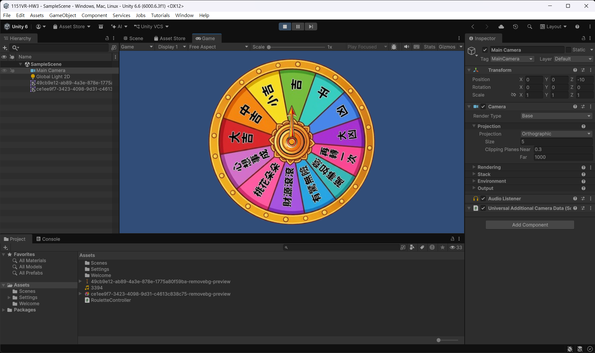

https://github.com/Qingfeng423/1151VR-HW3-414262129--
https://youtu.be/HAiJbtKE6mw
首先在 Unity Hub 中開一個新的 2D 專案，並將自己準備好的輪盤圖片（PNG 格式）與轉動音效檔直接拖曳至專案的 Assets 資料夾中。接著把輪盤圖片拉進 Scene 場景內，利用 Inspector 屬性面板將其座標 (Position) 設定在 (0, 0, 0) 確保完美置中。為了讓輪盤在轉動時能夠發出聲音，我們在輪盤物件上點擊 Add Component 新增了 Audio Source 元件，將音效檔案放入 Audio Generator 欄位，並且非常重要地取消勾選 Play On Awake，避免遊戲一開始音效就自動播放。 

在程式邏輯與控制部分，我們在 Assets 視窗中點擊右鍵建立了一個名為 RouletteController 的 C# 腳本，並把它掛載到輪盤物件上。程式碼透過 Update 函式與 Input 偵測滑鼠左鍵點擊（或螢幕點擊），當玩家點擊時會賦予輪盤一個初始的旋轉速度（rotSpeed），同時呼叫 audioSource.Play() 播放音效。為了讓輪盤呈現自然的動態，我們使用了 transform.Rotate 讓物件沿著 Z 軸轉動，並在每個影格讓速度乘上 0.96 的衰減係數，營造出逐漸減速直到停止的物理手感。當速度降低到極低時，程式會自動將速度歸零並停止音效播放。 

最後，我們透過 Build Settings 將專案平台切換至 Android ，並在 Player Settings 內的 Company Name 輸入個人識別名稱，確認場景正確加入後進行 Build 輸出。 

